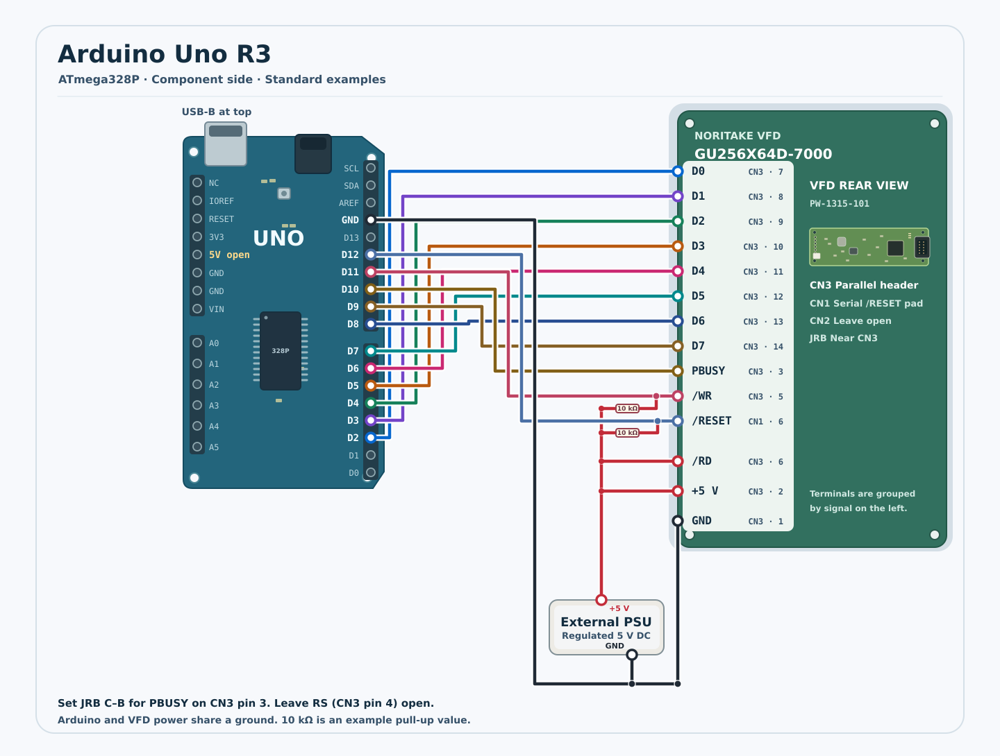

# GU256X64D7000 Arduino library

Drive the Noritake GU256X64D-7000 over its 8-bit parallel interface from
an Arduino board with native 5 V GPIO on all 11 VFD signals.

## Install

Copy this `GU256X64D7000` folder into the Arduino sketchbook's
`libraries` directory. To redistribute it, zip the folder with
`library.properties`, `src`, `examples`, and the license inside it.
Arduino IDE can install that ZIP using **Sketch > Include Library > Add
.ZIP Library**.

Arduino IDE lists these sketches under the library's examples.

- [HelloVFD](examples/HelloVFD/HelloVFD.ino) clears the display and writes
  built-in text. It includes alternate wiring for the Uno WiFi Rev2.
- [BitmapVFD](examples/BitmapVFD/BitmapVFD.ino) draws a centered 16×16 bitmap.

Both examples select direct port wiring on the Nano Every and Uno WiFi
Rev2. The portable examples use Uno R3, Mega 2560, Uno R4 Minima, or
SparkFun Pro Micro 5 V / 16 MHz pins.

For PlatformIO, choose `framework = arduino` and add the repository to
your project's `lib_deps`.

```ini
lib_deps =
    https://github.com/BeatGlow/GU256X64D7000.git
```

## Draw a BMP from an SD card

Open [SdCardBitmap](examples/SdCardBitmap) and install the
[Arduino SD library](https://docs.arduino.cc/libraries/sd/). Copy
`IMAGE.BMP` to the root of a FAT16- or FAT32-formatted card.

The example uses an SD module compatible with 5 V Arduino boards.
Connect the module to the board's hardware SPI pins and connect its CS
to D10. On an Uno R3, SPI uses D11 (MOSI), D12 (MISO), and D13 (SCK).
This example uses the following VFD wiring to leave those pins free.

| VFD signal | Arduino pin |
| --- | --- |
| D0–D7 | D2–D9, in order |
| PBUSY | A0 |
| /WR | A1 |
| /RESET | A2 |

On the Uno R4 Minima, use the [PBUSY buffer](#wiring-diagrams-for-the-standard-examples)
with its output connected to A0 for this sketch.

Use an uncompressed Windows BMP, either 1-bit with two palette entries
or 24-bit color, up to 256 pixels wide and 64 pixels tall. The lighter
palette entry lights the VFD in a 1-bit image. In a 24-bit image,
pixels with weighted brightness of 128 or higher light up. The sketch
draws at the top left and fills any unused rows in its last eight-row
band with dark pixels.

For example, use ImageMagick to make a compatible monochrome file.

```sh
magick input.png -resize '256x64>' -monochrome -type bilevel -compress none BMP3:IMAGE.BMP
```

The sketch reads the card by row and sends one eight-row band at a
time, using a maximum of 256 bytes for the band. Open the serial
monitor at 115200 baud for status.

## Common operations

Call `begin()` to configure the pins, then `initialize()` to pulse
`/RESET`, restore controller defaults, and clear the display.

| Operation | Method |
| --- | --- |
| Restore the controller's defaults without pulsing /RESET | `restoreDefaults()` |
| Clear the current window and move the cursor home | `clear()` |
| Move the cursor home or set its position | `home()`, `setCursor(x, band)` |
| Write printable ASCII in the built-in font | `writeText(text)`, `drawTextAt(x, band, text)` |
| Draw a complete monochrome rectangle | `drawBitmap(x, band, columns, bands, data)` |
| Set brightness from 1 (dimmest) to 8 (brightest) | `setBrightness(level)` |
| Switch display power | `setPower(enabled)` |
| Show or hide the cursor | `setCursorVisible(visible)` |
| Reverse subsequent writes | `setReverse(enabled)` |
| Scale the built-in font from 1 to 4 horizontally and 1 to 2 vertically | `setFontScale(horizontal, vertical)` |

These methods return `false` if an argument is invalid or the VFD
stays busy. Text takes a null-terminated ASCII string. The VFD handles
cursor advance and line wrapping. All coordinates use native VFD
units. X counts columns and Y counts bands of eight pixels. The current
VFD window determines which part of display memory is visible.

## Bitmap format

A bitmap contains one bit per pixel. Pack each vertical group of eight
pixels into a byte. Bit 7 is the top pixel and bit 0 is the bottom.
A 1 is a set pixel and a 0 is a clear pixel in the default write mode.

```text
Bit number:   7   6   5   4   3   2   1   0
            +---+---+---+---+---+---+---+---+
Pixel row:  | 0 | 1 | 2 | 3 | 4 | 5 | 6 | 7 |  within one band
            +---+---+---+---+---+---+---+---+
              ^                           ^
              top                         bottom
```

Write all bands for the leftmost column from top to bottom, then move
one column right. Given zero-based pixel coordinates `px` and `py`
within the bitmap, its byte offset is `px * bands + py / 8` and its bit
mask is `0x80 >> (py % 8)`. A bitmap is exactly `columns * bands` bytes
and `bands * 8` pixels high. For heights that are not multiples of
eight, round up to a whole band and supply the pixels for the extra rows.

The example below is two columns wide and 16 pixels high. The four
bytes travel in numbered order. Each cell shows one byte as eight
pixels, read from top to bottom.

```text
                         left column          right column
                     +-------------------+-------------------+
  first band (0..7)  | [0] 80  #.......  | [2] FF  ########  |
                     +-------------------+-------------------+
 second band (8..15) | [1] 01  .......#  | [3] 00  ........  |
                     +-------------------+-------------------+

  Wire order:  80 01 FF 00                  # set, . clear
```

```cpp
const uint8_t pixels[] = {0x80, 0x01, 0xff, 0x00};
vfd.drawBitmap(120, 3, 2, 2, pixels);
```

The call places the upper-left pixel at column 120, band 3 (pixel
row 24). The rectangle must fit within the controller's 512 columns
and eight bands of display memory. The current window determines
which part of that memory appears on the 256 × 64 panel.

The array overload infers the byte count. For a pointer, pass the
count after the pointer. To stream a bitmap, call `setCursor()` and
`beginBitmap(columns, bands)`, then use `writeBytes()` or `write()` to
send exactly the same number of bytes in the same order. `command()`
accepts raw controller commands.

## Set the wiring

Choose 11 available Arduino GPIOs that operate at 5 V. Pass the pins in
D0–D7, PBUSY, /WR, /RESET order.

```cpp
#include <GU256X64D7000.h>

using BoardWiring = gu256x64d7000::ArduinoWiring<2, 3, 4, 5, 6, 7, 8, 9, 10, 11, 12>;
gu256x64d7000::Display<BoardWiring> vfd;
```

On the SparkFun Pro Micro 5 V / 16 MHz, use `A0` and `A1` in place
of pins 11 and 12. Follow the diagram for your board to wire the VFD
and its power supply.

### Wiring diagrams for the standard examples

[](extras/wiring/arduino-uno-r3.svg)

Each link opens a full-size diagram. Orient the Arduino with the
component side facing you and its USB connector at the top.

| Board | Pins for VFD D0–D7, in order | PBUSY | /WR | /RESET |
| --- | --- | --- | --- | --- |
| [Arduino Uno R3](extras/wiring/arduino-uno-r3.svg) | D2–D9 | D10 | D11 | D12 |
| [Arduino Mega 2560 Rev3](extras/wiring/arduino-mega-2560.svg) | D2–D9 | D10 | D11 | D12 |
| [SparkFun Pro Micro 5 V / 16 MHz](extras/wiring/sparkfun-pro-micro-5v.svg) | D2–D9 | D10 | A0 | A1 |
| [Arduino Uno R4 Minima](extras/wiring/arduino-uno-r4-minima.svg) | D2–D9 | D10 via buffer | D11 | D12 |
| [Arduino Nano Every](extras/wiring/arduino-nano-every.svg) | A3, A2, A1, A0, A6, A7, D9, D10 | D6 | D4 | D2 |
| [Arduino Uno WiFi Rev2](extras/wiring/arduino-uno-wifi-rev2.svg) | A0–A5, D9, D10 | D3 | D5 | D7 |

Power the VFD from its own external regulated 5 V supply sized for the
display's startup inrush. Join Arduino GND, VFD GND, and PSU GND. Leave
the Arduino 5 V supply pin open. Use the VFD supply to tie /RD high and
to pull /WR and /RESET high while the Arduino starts. The diagrams show
10 kΩ example pull-up resistors. [Noritake power specifications](https://noritake-itron.com/site2017/images/Specs/VFD/CDG/GU256X64D-7000x/gu256x64d-7000_e01-c5.pdf)

The pin numbers apply to the original GU256X64D-7000. The diagram groups
the module terminals by function. Locate each connector's pin 1 on the
physical module. Set jumper JRB to C–B for PBUSY on CN1 pin 3, leave RS
(CN1 pin 4) open, and use /RESET on CN2 pin 6. Check the hardware
specification for your model if the module has a different suffix.
[Original module connector specification](https://noritake-itron.com/site2017/images/Specs/VFD/CDG/GU256X64D-7000x/gu256x64d-7000_e01-c5.pdf)

On the Uno R4 Minima, use the 5 V noninverting buffer shown for PBUSY.
The VFD's guaranteed PBUSY high of 3.8 V is below the R4's 4.0 V input
threshold at a 5 V supply. Connect VFD PBUSY to A (pin 2) and route Y
(pin 4) to Arduino D10 for the standard sketches or A0 for SdCardBitmap.
Ground /OE (pin 1) and GND (pin 3), and decouple VCC (pin 5) with 100 nF. [RA4M1 datasheet](https://www.renesas.com/en/document/dst/ra4m1-group-datasheet), [SN74AHCT1G125 datasheet](https://www.ti.com/lit/ds/symlink/sn74ahct1g125.pdf)

### ATmega4809 direct-port wiring

Use AVR port letters and bit numbers from the board pinout. Avoid pins
reserved for the board's peripherals or clock. `Display<>` selects the
Nano Every wiring on this MCU.

| Signal | ATmega4809 port bits | Nano Every pins |
| --- | --- | --- |
| D0 through D5 | PD0 through PD5 | A3, A2, A1, A0, A6, A7 |
| D6 and D7 | PB0 and PB1 | D9 and D10 |
| PBUSY | PF4 | D6 |
| /WR | PC6 | D4 |
| /RESET | PA0 | D2 |

Pass a different wiring type to the constructor when the board uses
other port bits. The type lets the compiler resolve every register and
mask before the program runs. This example keeps the Nano Every data
bus and uses different control pins.

```cpp
#include <GU256X64D7000.h>

using namespace gu256x64d7000;
using BoardWiring = Wiring<
    SplitData<Port::D, 0, 6, Port::B, 0>,
    Pin<Port::F, 5>,  // PBUSY
    Pin<Port::B, 2>,  // /WR
    Pin<Port::A, 1>   // /RESET
>;
Display<BoardWiring> vfd{BoardWiring{}};
```

Choose the data bus type to match the wiring.

- `DataPort<Port::D>` writes a whole port at once. Connect VFD D0 through
  D7 to MCU bits 0 through 7 of a single dedicated port.
- `SplitData<Port::D, 0, 6, Port::B, 0>` uses two consecutive groups.
  The arguments are the low port, its first bit, the number of low
  data bits, the high port, and its first bit. Wire each group in order.
  Groups starting at bit 0 avoid extra shifts.
- `DataPins<Pin<...>, ...>` accepts eight individual pins in VFD data
  order. It still writes the AVR virtual ports directly. Scattered
  wiring takes more instructions to assemble the output bytes.

With direct-port wiring, `writeBytes` captures the unrelated output bits
once before sending.
Keep other code, including interrupt handlers, from changing output
latches on those ports during a burst. `write` captures them per byte.
Both wait for PBUSY before driving data and strobing /WR. The caller
handles a timeout by resetting and reinitializing the panel before retrying
a partially transmitted command.

## Development

Install [pre-commit](https://pre-commit.com/) and run `pre-commit install`.
Run `pre-commit run --all-files` to format the code and test the command
API with a host C++ compiler. In CI, the hook and Library Manager checks
run first. Both examples then compile across the six boards in parallel.
The emulator and PlatformIO matrices run after the Arduino builds pass.
